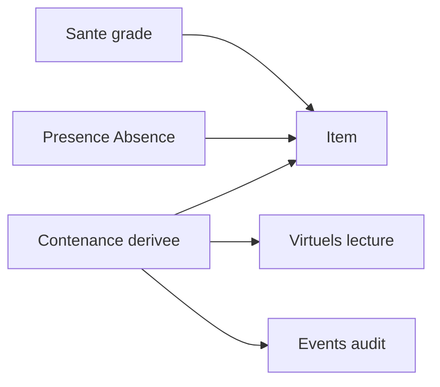

# Cycle de vie scellé & possession virtuelle

**Statut :** plan produit validé contre le code — **pas d’implémentation** (2026-11-07).  
**Passation détaillée :** [`2026-11-07-passation-cycle-scelle.md`](./2026-11-07-passation-cycle-scelle.md).  
**Lié :** plan Cursor *Absence étagère* ; [`collection_checklist.md`](../collection_checklist.md) § scellé (2026-08-15/16) ; [`sealed_product_contents.md`](../sealed_product_contents.md).

## Intention

- Un **produit scellé** (display, deck, boîte…) est un item d’étagère de premier rang — pas seulement les cartes. Aujourd’hui le **parcours UX TCG** (PrintPicker) pousse les cartes ; l’API accepte déjà name/barcode — il manque un parcours **SKU scellé → Item**, pas un garde-fou.
- Contenu **connu** → **virtuels** (annoncés, pas en main). Ex. boîte Leclerc / Fixeez. Compter ou non les virtuels = **réglage de vue**, pas vérité globale.
- Après ouverture : contenus = vrais items indépendants ; la boîte = même item → coquille (**shell**) gardée ou `past` ; filiation « issu de… » conservée.
- Un item **a été eu** peut ne plus être possédé (`past`) : Exit joués puis jetés. **Ne pas** le proposer à l’achat par défaut ; action « je la recherche » → `wanted` en gardant l’historique.

## Bug checklist actuel (vérifié)

[`checklist/route.ts`](../../src/app/api/shelves/[shelfId]/checklist/route.ts) charge tous les items à `printKey` **sans** filtrer `presence`. Donc `past` **et** `wanted` comptent aujourd’hui comme **possédés** (sortent des manquants). `countsAsOwned` n’y est **pas** branché.

**Règle de livraison :** exclure `past`/`wanted` du set « vraiment possédé » **et** introduire le statut **« déjà eu »** dans **le même** changement — sinon les cartes vendues/jetées réapparaissent en « à acheter ».

Seuls les items à `printKey` entrent dans `owned` : un scellé sans printKey est **invisible** à la checklist tant qu’on n’a pas de lien SKU.

## Ce que font les autres apps

| Famille | Exemples | Sealed | Rip | Grade | Virtuel / timeline |
|---|---|---|---|---|---|
| Portfolio | Collectr, PK.TCG, Eyevo, Rarebox | Ligne inventaire à côté des singles | Retirer scellé + ajouter cartes à part | PSA ≠ raw | Non |
| Rip + cost basis | TCG Ledger, Manapulse, Sleeve | Boxes valués | Coût réparti sur les hits | Slabs / WIP | Non |

**Différenciateur Placarr :** display progressive, pile, shell, virtuels garantis, timeline de contenance + Absence — sans devenir un pur portfolio.

## Trois axes orthogonaux

Ne **pas** mettre « scellé » dans `Condition`.

1. **Santé / grade** — neuf, used, damaged… ; slabs PSA/CGC/BGS + note. Aussi sur blister corned ou shell.
2. **Contenance** — **dérivée** des liens (pas d’enum stocké fragile) : `sealed` / `partial` / `emptied` ; stocker `openedAt`. Shell = item séparé (`role: shell`).
3. **Présence** — Absence : `owned` \| `away` \| `wanted` \| `past` (+ raison).

## Virtuels — approche A (MVP)

- **Dérivés à la lecture** depuis le catalogue (`guaranteedPrints` / arbre), pas de lignes `virtual` en base.
- Conditions : `contentsKnown`, pas `printsArePreview`, parent non vidé, présence `owned`|`away`.
- Display aléatoire : **pas** de virtuel carte-à-carte — N boosters réels (`packsContained`).
- Matérialiser **seulement** à l’ouverture.
- Grille / checklist : filtres par étagère (voir § Décisions tranchées). Statut distinct « virtuelle ».
- Approche B (lignes en base) = repli si perf / UX l’exigent plus tard.

Virtuels sous parent `away` / « attendu » : **tranché** — affichés virtuels, hors « possédé reçu », inclus compteur + exports ; livrer ensemble (voir § Décisions tranchées).

## Contenance & ouverture

- Table `ItemContainmentLink` ≈ `ItemTradeLink` : `parentId`, `childId`, `role` (`content`|`shell`), `eventId`.
- Display → **N items** boosters liés si `packsContained` connu ; si `null` → **rien généré** à l’ouverture, complément catalogue manuel (fiche SKU indépendante).
- Known / mixed : ouverture via `toContentsTree` / `expandBuyImpact` ([`sealedContentsTree.ts`](../../src/core/collect/sealedContentsTree.ts)) — **ne pas** réécrire l’arbre. `itemSealedContainment.ts` = index catalogue « Inclus dans », **autre rôle**.
- Random : rip **unitaire** et déclaration **groupée** autorisés **ensemble** sur la même display (déclaration partielle OK ; doublons en pile non saisie).
- À l’ouverture : enfants = items **autonomes** (vente / échange / prêt) ; éléments type règles / puzzles = **manuel** (ajout ou déclaration de jet), pas d’automatisme.
- Shell optionnel ; jamais delete silencieux du parent.
- Item scellé porte `kind` (carte|scellé|shell) + clé SKU `pack::slug` + snapshot nom/langue à l’acquisition (les slugs catalogue peuvent disparaître).
- Colonnes : **prix d’achat**, **date d’acquisition** (distincts de `createdAt` / `absencePriceCents`).

Journal : colonnes Item = vérité ; events = **audit** append-only. Étendre `ItemPresenceEvent.kind` (`opened`, `materialized`, `declared`…) avec snapshot figé — plutôt qu’une 2ᵉ timeline au départ.

## Statut d’affichage unifié (checklist)

Calculer **une fois**, consommer partout :

1. possédée **reçue / en main** ;
2. possédée mais absente (`away` + raison) ;
3. virtuelle (dans scellé fermé `owned`|`away`) — compte possession / exports, pas « reçue » ;
4. **déjà eue** (`past`) ;
5. manquante.

Basculement de vue **« en main »** vs **« tout possédé (scellé compris) »**. Filtres par étagère (mémorisés, modèle filtre checklist) : voir les virtuels oui/non ; ne voir que les virtuels oui/non ; inclure les **déjà eus** dans la liste oui/non (badge si visibles). Défaut : « déjà eue » **pas** dans le panier d’achat ; « je la recherche » → `past`→`wanted` en gardant l’historique.

`buyAdvice` reste pur ; virtuels / déjà-eu agissent **en amont** sur `missing` / `owned`.

## Ordre d’étapes

0. **Checklist presence + déjà eu** (même PR) — exclure `past`/`wanted` du « vraiment possédé » via `countsAsOwned` / prédicats unifiés ; checkbox checklist à **trois états** (vide / plein / intermédiaire-indéterminé) pour refléter present / past / wanted ; statut **« déjà eu »** visible sur l’item ; option d’affichage **mémorisée par étagère** : exclure totalement les déjà eus, ou les garder visibles avec badge (cas typique : jeté / vendu → ne pas racheter) ; tests.
1. Pures : `containmentState()`, `virtualContents()`, statut unifié + tests (booster, display partielle, deck `away`, `contentsKnown=false`, `past`).
2. Schéma (décision 7 tranchée) : kind, SKU key, `openedAt`, prix/date acquisition, `ItemContainmentLink`, kinds d’events.
3. Ajout scellé depuis catalogue (modal) + event `acquired` + snapshot.
4. Ouverture known_bundle (un chemin complet) + shell optionnel + transaction.
5. Statut unifié + bascule en main / tout possédé + filtres virtuels par étagère + amont conseil d’achat.
6. Display, pile, partial, rip unitaire + déclaration groupée (y compris partielle).
7. Suites : timeline UI, cost basis rip, slabs/WIP grading, raison « attendu » élargie, raisons absences sparses (`consumed`… seulement si filtre décision 6).

## Décisions figées

1. Scellé = item de premier rang.
2. Virtuels = réglage de vue (par étagère).
3. Parent conservé (shell / emptied), enfants indépendants + filiation.
4. `past` = déjà eu, pas « à acheter » par défaut (corriger le bug actuel).
5. Peu de présences ; raisons sparses ; champs optionnels.
6. Santé ≠ contenance ≠ présence.
7. Virtuels MVP = dérivation (A) ; arbre d’ouverture = `sealedContentsTree`.
8. Ne pas réintroduire `LoanRequest`.

## Décisions tranchées 2026-11-07

1. **Virtuels sous scellé `away` / « attendu »** — affichés comme virtuels ; exclus du statut « possédé reçu » ; **comptent** dans le compteur de possession et les exports checklist. Livrer ces trois comportements **ensemble** (pas d’entre-deux où ils disparaîtraient des manquants sans compter ailleurs).
2. **Ouverture → items autonomes** — le déballage crée des items à états individuels (vente, échange, prêt). Éléments garantis hors cartes (règles, puzzles…) : **pas d’automatisme** — ajout ou déclaration de jet **manuel** par l’utilisateur.
3. **`packsContained = null`** — à l’ouverture, **rien n’est généré** ; complément **manuel une fois** au catalogue. Chaque nœud d’un arbre SKU = **fiche indépendante** : un booster n’implique pas la display ; un poster checklist n’implique pas les boîtes.
4. **Rip unitaire + déclaration groupée** — autorisés **ensemble** sur une même display ; déclaration **partielle** possible ; doublons en pile **non saisie**.
5. **Vues possession** — bascule « en main » vs « tout possédé (scellé compris) ». Filtres par étagère : voir les virtuels oui/non ; ne voir que les virtuels oui/non ; inclure les **déjà eus** oui/non (masqués, ou visibles avec badge). Options **mémorisées par étagère**, sur le modèle du filtre checklist existant.
6. **Checkbox checklist (étape 0)** — trois états : vide / plein / intermédiaire-indéterminé ↔ present / past / wanted ; badge « déjà eu » sur l’item ; pas de rachat forcé pour jeté / vendu.
7. **Découpage données item (validé)** — chaque objet porte un **type** (carte, booster, puzzle, pack…), une **référence catalogue** unique, une **date d’ouverture**, un **prix** et une **date d’achat**. Les **liens** expriment la contenance (un pack contient d’autres objets / codes). Les **événements** journalisent ce qui s’est passé (ouvert, prêté, reçu…). Tant qu’un pack est **scellé**, ses contenus **n’existent pas** comme objets séparés : ils sont **décrits à l’intérieur** (catalogue / dérivation). À l’**ouverture**, l’appli **génère une ligne par contenu**. Un **prêt** ajoute un événement **sans** toucher aux contenus.
8. **Statut vide / non vide + gestion des liens (validé)** — un produit a un statut **vide** ou **non vide** selon ce qu’il contient encore. On peut gérer les liens de contenance **dans les deux sens** : depuis l’objet contenu (ex. un booster) **ou** depuis le contenant (ex. une display).
9. **Remontage après détachement (validé)** — **oui**, on peut rattacher un objet sorti d’un contenant. Depuis l’item (ex. un booster), l’appli propose les items de l’étagère (virtuels ou non) dont la **composition connue** prévoit ce type d’objet ; on **choisit** celui dans lequel le remettre (le même qu’avant, ou un autre).

## Risques ouverts

- Blister `pack_container` ×1 : une ou deux étapes d’ouverture (vs items autonomes déjà tranchés) ?

## Critère de succès

1. Trois axes sans conflation.
2. Checklist : vrai / absent / virtuel / déjà eu / manquant — cohérent avec l’achat.
3. Display → pile ; shell ; timeline.
4. Known → matérialisation ; random → déclaration honnête.
5. Aucun faux contenu confiant (`contentsKnown` / pas preview).
